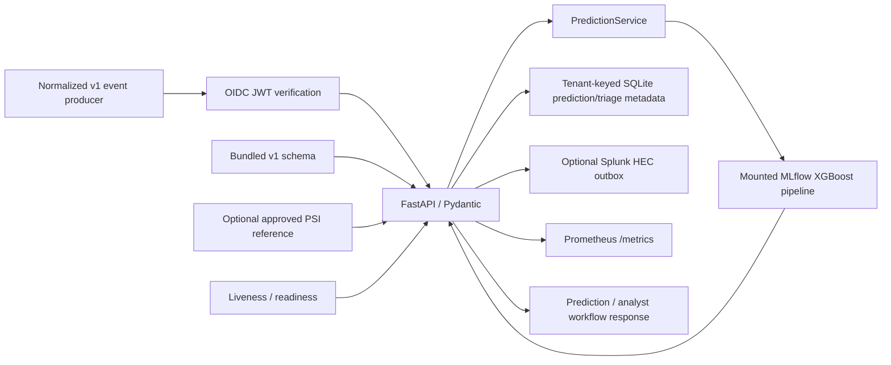
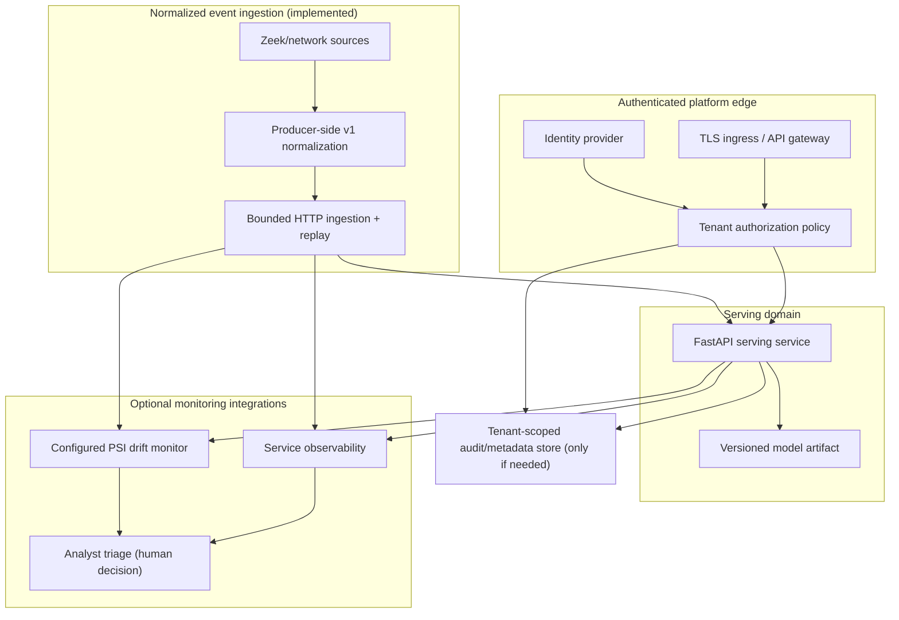

# Technical Architecture

## Status and scope

This document separates verified local behavior from proposed platform architecture.
The service is a single Python/FastAPI process with a mounted, explicitly selected
MLflow model. Local normalized-event ingestion, optional OIDC tenant authentication,
tenant-scoped investigation state, optional Splunk HEC delivery, and configurable PSI
monitoring have been added and unit/integration tested. They have not been deployed
to a trusted identity provider, Splunk, or production infrastructure.
A separate local Kind learning lab was verified before these changes and is not a
production Kubernetes deployment.
The exceptional Milestone 1 scores do not establish production generalization; see
[the readiness review](../reports/milestone-1-readiness.md).

GCP is selected as the target for a no-apply Terraform configuration; no GCP project,
Terraform state bucket, or cloud deployment is configured. The local Kind lab uses
a dedicated local cluster. No paid infrastructure is approved or provisioned.
Production apply, deployment, or external exposure still requires explicit review
and approval.

## Implemented and locally verified architecture

- **Model serving:** one API process loads the selected XGBoost preprocessing/model
  pipeline during startup. Prediction is reusable through `PredictionService`.
- **Contract:** `schemas/network-flow-model-input-v1.schema.json` defines 30
  features. The API rejects extra/missing fields and does not parse raw Zeek logs.
- **Ingestion:** `/v1/ingest` accepts bounded batches of normalized events,
  derives tenant scope from OIDC claims, deduplicates by tenant/event ID and content
  digest, and links outputs to caller-provided evidence references.
- **Investigations:** event metadata and analyst acknowledgment/dismissal are
  tenant-scoped. Predictions only recommend analyst review; no disruptive action
  is automated. The optional SQLite store persists metadata only, never raw features.
- **Integrations:** optional HTTPS Splunk HEC receives prediction/evidence and
  human-triage events;
  Prometheus metrics, JSON request logs, correlation IDs, configurable PSI windows,
  and example Grafana/alert rules are implemented. No live integration was exercised.
- **Container operations:** digest-pinned Python base, `uv.lock`, OpenMP runtime,
  non-root `app` user, read-only model mount, readiness health check, and locally
  exercised CPU/memory limits.
- **Not present or externally verified:** raw Zeek normalization, a durable broker,
  production IdP/Splunk/Prometheus, a validated operational drift baseline, live alert
  routing, production Terraform deployment, and production reliability evidence.
  The updated GitHub Actions gates have not yet run on GitHub; earlier CI passed on
  the `main` push commit recorded in the
  [Milestone 3 report](../reports/milestone-3-report.md). The manually triggered
  GHCR workflow is implemented but has not been run; image publication and
  provenance verification remain pending.

## Separate local Kubernetes learning lab

The Kind lab is a distinct infrastructure-learning track, not a replacement for
M4 or a production deployment. It reuses the existing image and mounts the
operator-selected model through a read-only host-backed local PV/PVC. The host
mount is explicitly local-only; the pod itself uses the restricted Pod Security
profile, a no-token service account, and no RBAC grants. Actual pod, endpoint,
inference, rollout, rollback, and recovery evidence is recorded in [the local lab
report](../reports/local-kubernetes-lab-report.md), and deployment instructions
are in [the lab guide](local-kubernetes-lab.md). This verifies a local
single-node learning deployment only; it does not satisfy production scheduling,
scaling, availability, or artifact provenance requirements.

See the [Milestone 2 report](../reports/milestone-2-report.md) for actual local
verification results. Docker image operation is currently single-process CPU
inference with no distributed coordination.

## Target platform architecture (proposed, gated)

Keep deployment as a modular platform, not a collection of services by default.
Split a component into a separately deployed service only when independent scaling,
security boundary, availability objective, or team ownership justifies its operational
cost.

The diagram is a target boundary map, not a claim that these services or data paths
exist. Start with logical Python modules and platform-managed dependencies where
that is sufficient. In particular, use one streaming platform service only after
event delivery, replay, ordering, retention, and back-pressure requirements justify
it; use a drift-monitoring job/service only after a trusted feature/label feedback
path exists.

### Platform service boundaries

| Boundary | Responsibility | Contract and isolation |
|---|---|---|
| Model serving | Validate normalized records, load an approved immutable model version, return scores and metadata | Schema version, model ID, threshold; authenticated tenant context required before any multi-tenant exposure |
| Telemetry normalization | Map Zeek connection/protocol logs into the 30-feature contract, joining by source connection identity | Versioned mapping, explicit direction/time semantics, null for unavailable values; never infer fields silently |
| Streaming ingestion (implemented HTTP boundary) | Accept/replay bounded batches of normalized events, tenant/event dedupe, optional HEC delivery | OIDC claim establishes tenant; no raw Zeek parsing, durable broker, ordering guarantee, or back-pressure queue |
| Drift monitoring (optional implementation) | PSI compares configured numeric/categorical feature windows against a supplied reference | Per-tenant in-memory windows; no baseline is bundled, reset on restart, aggregate metrics omit tenant IDs; drift is not accuracy |
| Observability | Latency, availability, validation failures, model load/inference faults, saturation, queue lag | Avoid raw payloads, IPs, DNS names, or tenant data in metric labels/logs |
| Platform control plane (future) | IaC state, environment config, approved model references, policy and audit trail | Least privilege, separated environments, protected state and deployment identities |

These are interface/ownership boundaries first. Avoid adding microservices until a
specific operational constraint demonstrates the need.

## Identity, authorization, and multi-tenancy (application boundary implemented)

When OIDC is configured, the service validates an HTTPS-JWKS signature, issuer,
audience, expiry, subject, tenant claim, and role list. It never accepts tenant scope
from event JSON or headers. `events:write` (or `admin`) is required to ingest;
`analyst` (or `admin`) is required to read or triage investigations. Tenant-aware
SQL keys/queries and process-local ingestion quotas isolate events, predictions, and
triage records. When OIDC is not configured, existing prediction endpoints retain
the explicitly single-tenant local behavior; new tenant ingestion and investigation
routes fail closed.

Application tests verify valid signed claims, invalid issuer/audience/expiry/tenant,
forged event tenant fields, two-tenant cross-read denial, role denial, and rate-limit
scoping. This is **not production authorization evidence**: no live IdP, ingress,
deployed policy, token rotation, or admin workflow has been verified. The SQLite
store has no at-rest encryption, retention/deletion, backup/restore, or multi-process
coordination; the rate limiter resets on process restart. Shared production exposure
remains blocked until the threat model, data lifecycle, deployed-policy tests, and
security review pass. See [ADR 0003](adr/0003-multi-tenancy-security-gate.md).

## Infrastructure, Linux, and scheduling direction

### Terraform (GCP configuration validated; no resources provisioned)

- Reusable GCP modules and separate `dev`/`prod` roots define a private VPC/subnet,
  Cloud NAT, private Autopilot GKE, Artifact Registry, a versioned private model
  bucket, and bucket-scoped Workload Identity.
- GCS state backends require a separately pre-created, approved bucket and distinct
  prefixes; example backend files are placeholders. State is not present in Git.
- Application Default Credentials/environment configuration are used for provider
  access. Project IDs are variables; no credentials are committed.
- Require `terraform fmt -check`, `terraform validate`, policy/security checks,
  and a reviewed plan. CI may plan but must not apply infrastructure without an
  approved, protected deployment workflow. Reproducibility includes pinned
  providers/modules, environment-specific provider lockfiles, versioned inputs,
  and recorded plan provenance. `scripts/validate_terraform.sh` validates with
  backend initialization disabled. No plan or apply was run.
- The serving process still consumes a mounted model volume and does not download
  from GCS. No cloud IAM/project permissions, paid resources, or actual deployment
  were tested. See [Terraform notes](../infra/terraform/README.md) and
  [ADR 0004](adr/0004-terraform-state-and-environments.md).

### Linux and container operations

Current verified controls include a non-root container user, read-only model mount,
health check, and a locally exercised 1 GiB/1 CPU Docker limit. Operational runbooks
should cover `docker inspect`, `docker logs`, process/exit status, UID/GID and file
permissions, mount readability, DNS/routes/port binding, health transitions, cgroup
memory/CPU counters, graceful SIGTERM, and recovery after process/node restart.

Future deployment must set requests and limits from measured load, avoid privileged
containers and writable root filesystems where compatible, drop capabilities,
restrict egress/ingress, and verify the mounted model is readable only by the
service identity. Do not increase replicas or worker counts based on assumption;
measure CPU, memory, latency, and model-load behavior first.

### Kubernetes worker-node scheduling and scaling (not production-verified)

The reusable Helm chart templates a single FastAPI replica with probes, resource
limits, non-root/read-only security context, a read-only model claim, and a
configurable event-store claim. Development and production values lint and render.
No Helm release was installed. SQLite requires exactly one replica; horizontal
scaling is intentionally rejected until a shared durable store/outbox replaces it.

- Run serving pods on a CPU inference node pool using resource requests/limits,
  topology spread across failure domains, readiness/liveness probes, graceful
  termination, and a disruption budget appropriate to replica count.
- Use node labels/affinity and taints/tolerations to keep general serving workloads
  off specialized/GPU pools unless a measured model requirement justifies it.
- Scale pods from measured request rate/latency and CPU or a meaningful queue metric;
  scale worker nodes through the cluster autoscaler only after pod pending/saturation
  evidence. Configure min/max bounds, cooldowns, quotas, and scale-to-zero behavior
  explicitly; protect against autoscaler loops and cold model-load spikes.
- Validate that HPA targets match actual bottlenecks. A CPU threshold alone does not
  guarantee latency or throughput. Do not set replica counts or worker-node sizes
  from the current synthetic smoke test.

“Node” here means Kubernetes worker node. Node.js is not part of this platform:
FastAPI, model loading, telemetry normalization, and likely future streaming clients
are Python-native; no genuine application requirement justifies adding a Node.js
runtime or toolchain.

## Reliability, observability, and incident response

Prometheus metrics, example alert rules, a Grafana dashboard, JSON request logs,
correlation IDs, configurable PSI thresholds, and manual tenant-scoped triage are
implemented. No Prometheus/Grafana server, alert route, live drift baseline, or
production incident exercise has been verified. No production SLOs have been
measured. Proposed
initial acceptance targets (to be approved and baselined in CI/CD before deployment):

- Serving availability at least **99.5% over a rolling 30-day window** after an
  authenticated production environment exists; exclude planned maintenance only
  under a documented policy.
- In a documented representative CPU load test: p95 inference latency **≤250 ms**
  at **20 requests/second for 30 minutes**, with **<1% server errors** and no OOM
  restarts. These are proposed thresholds, not current measurements; calibrate load
  against actual payload and capacity before adopting.
- Startup readiness within **60 seconds** for the approved artifact; model/schema
  mismatch must fail closed and be alertable.
- Recovery exercise: restore a non-production service from a pinned image/model
  reference within **30 minutes**, with no undeclared model/config drift.

The current metrics cover model inference outcomes/latency, ingestion outcomes and
errors, Splunk delivery errors, and maximum PSI by configured feature across tenant
windows. They do not label by tenant, event, source IP, or model ID. Alert rules are
examples and have not been loaded or routed. Extend monitoring for saturation,
ready replicas, model load failures, container restarts/OOM, and stream lag/drops
if a durable queue is introduced. Alert only on actionable symptoms with runbook links;
do not use tenant IDs, raw event attributes, IPs, or high-cardinality data as metric
labels. Define alert thresholds from baseline and error budget.

Incident response must document severity/owner/escalation, impact and tenant scope,
containment (disable endpoint/tenant/model or roll back), evidence handling, recovery,
communications, and a blameless post-incident review. Failure-injection drills should
cover missing/corrupt model, schema mismatch, authorization failure, slow inference,
memory exhaustion, pod/node loss, dependency outage, queue back-pressure, and failed
state/backup recovery. Record injected fault, detection time, mitigation/recovery
time, data loss, and follow-up actions. Do not claim incident readiness until drills
are executed and outcomes reviewed.

## Architecture governance

- Keep diagrams in this document and update them in the same review as service,
  identity, data-flow, or deployment-boundary changes.
- Record durable decisions in [ADRs](adr/). ADRs are proposed/accepted/rejected with
  status, context, decision, alternatives, consequences, security/operations impact,
  owner, and superseding ADR.
- Record design reviews in [design-reviews](design-reviews/). A review is not an
  approval: capture reviewers, scope, threat/data-flow review, reliability/cost,
  alternatives, action owners, and explicit approval/block status.
- Require security/privacy, platform operations, ML/data, and cost review for
  changes crossing their boundaries. No paid resources, production apply, or
  deployment without user approval.

See the [roadmap and acceptance evidence](roadmap.md) for the ordered gates.
