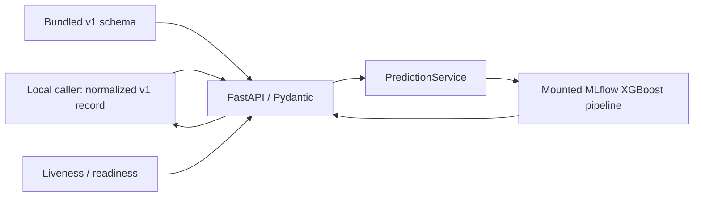

# Technical Architecture

## Status and scope

This document separates verified local behavior from proposed platform architecture.
The current service is a single Python/FastAPI process with a mounted, explicitly
selected MLflow model. It is not authenticated, multi-tenant, deployed to Kubernetes,
or connected to live telemetry. The exceptional Milestone 1 scores do not establish
production generalization; see [the readiness review](../reports/milestone-1-readiness.md).

No cloud provider, Terraform backend, Kubernetes cluster, or production network
topology has been selected. No paid infrastructure is approved or provisioned.
Planned components below require design review and explicit approval before apply,
deployment, or exposure.

## Implemented and locally verified architecture

- **Model serving:** one API process loads the selected XGBoost preprocessing/model
  pipeline during startup. Prediction is reusable through `PredictionService`.
- **Contract:** `schemas/network-flow-model-input-v1.schema.json` defines 30
  features. The API rejects extra/missing fields and does not parse raw Zeek logs.
- **Container operations:** digest-pinned Python base, `uv.lock`, OpenMP runtime,
  non-root `app` user, read-only model mount, readiness health check, and locally
  exercised CPU/memory limits.
- **Not present:** authentication, authorization, tenant identity, live ingestion,
  drift monitoring, external metrics/logging, Terraform, Kubernetes,
  incident-response automation, or production reliability evidence. GitHub Actions
  CI and a manually triggered GHCR release workflow are implemented locally; hosted
  execution, image publication, and provenance verification remain pending.

See the [Milestone 2 report](../reports/milestone-2-report.md) for actual local
verification results. Docker image operation is currently single-process CPU
inference with no distributed coordination.

## Target platform architecture (proposed, gated)

Keep deployment as a modular platform, not a collection of services by default.
Split a component into a separately deployed service only when independent scaling,
security boundary, availability objective, or team ownership justifies its operational
cost.

The diagram is a target boundary map, not a claim that these services or data paths
exist. Start with logical Python modules and platform-managed dependencies where
that is sufficient. In particular, use one streaming platform service only after
event delivery, replay, ordering, retention, and back-pressure requirements justify
it; use a drift-monitoring job/service only after a trusted feature/label feedback
path exists.

### Platform service boundaries

| Boundary | Responsibility | Contract and isolation |
|---|---|---|
| Model serving | Validate normalized records, load an approved immutable model version, return scores and metadata | Schema version, model ID, threshold; authenticated tenant context required before any multi-tenant exposure |
| Telemetry normalization | Map Zeek connection/protocol logs into the 30-feature contract, joining by source connection identity | Versioned mapping, explicit direction/time semantics, null for unavailable values; never infer fields silently |
| Streaming ingestion (future) | Durable delivery, replay, bounded buffering, ordering/partition policy, back-pressure | Tenant/source identity established by trusted producer metadata, not caller-supplied feature fields |
| Drift monitoring (future) | Detect feature/input distribution changes and compare approved labeled outcomes when available | Tenant-aware aggregation, minimum cohort sizes, retention and access controls; drift is not accuracy |
| Observability | Latency, availability, validation failures, model load/inference faults, saturation, queue lag | Avoid raw payloads, IPs, DNS names, or tenant data in metric labels/logs |
| Platform control plane (future) | IaC state, environment config, approved model references, policy and audit trail | Least privilege, separated environments, protected state and deployment identities |

These are interface/ownership boundaries first. Avoid adding microservices until a
specific operational constraint demonstrates the need.

## Identity, authorization, and multi-tenancy (not implemented)

**Current status: single-tenant local API; no authentication or tenant isolation. Do not
claim multi-tenancy or expose it as a shared service.**

Before a shared deployment:

1. Authenticate a caller through a selected trusted identity provider or workload
   identity. Derive immutable tenant identity from verified claims, not request JSON,
   headers controlled by the caller, or a feature field.
2. Authorize tenant, role, model, and operation on every request. Fail closed for
   absent/ambiguous identity; define administrative access separately and audit it.
3. Pass an immutable tenant context through the request lifecycle. Scope inference
   quotas, audit events, caches, asynchronous work, drift aggregates, and any
   persisted inputs/results by that context.
4. Decide whether model artifacts are shared across tenants or isolated per tenant.
   Keep request data ephemeral by default. If retained data is needed, specify
   encryption, retention, deletion, backups, and tenant-keyed access controls.
5. Add automated negative tests with at least two tenants proving forged identity,
   cross-tenant model selection, record/audit reads, cache collisions, and background
   task access are denied. Use separate tenant test fixtures and assert no data bleed.
6. Run authorization tests against the deployed policy/configuration, not only unit
   mocks; retain auditable evidence. Until all gates pass, deploy a single authorized
   operator boundary only.

Multi-tenancy is a security design requiring review, not a feature toggle.

## Infrastructure, Linux, and scheduling direction

### Terraform (planned; no resources provisioned)

- Use reusable, versioned modules for network primitives, workload identity,
  container registry access, secrets references, observability primitives, and
  compute only after choosing a provider and receiving approval.
- Keep environment roots/configuration separate (for example `dev`, `stage`,
  `prod`) with distinct identities, state keys, policy, and account/project
  boundaries where available. Promote a reviewed immutable artifact; do not copy
  mutable environment state.
- Remote state must use an approved encrypted backend with locking/concurrency
  control, least-privilege state access, versioning/recovery, restricted state
  outputs, and audit logging. Never commit state, plans containing secrets, or
  credentials. Backend/provider selection is a design-review decision.
- Require `terraform fmt -check`, `terraform validate`, policy/security checks,
  and a reviewed plan. CI may plan but must not apply infrastructure without an
  approved, protected deployment workflow. Reproducibility includes pinned
  providers/modules, lockfiles, versioned inputs, and recorded plan provenance.

### Linux and container operations

Current verified controls include a non-root container user, read-only model mount,
health check, and a locally exercised 1 GiB/1 CPU Docker limit. Operational runbooks
should cover `docker inspect`, `docker logs`, process/exit status, UID/GID and file
permissions, mount readability, DNS/routes/port binding, health transitions, cgroup
memory/CPU counters, graceful SIGTERM, and recovery after process/node restart.

Future deployment must set requests and limits from measured load, avoid privileged
containers and writable root filesystems where compatible, drop capabilities,
restrict egress/ingress, and verify the mounted model is readable only by the
service identity. Do not increase replicas or worker counts based on assumption;
measure CPU, memory, latency, and model-load behavior first.

### Kubernetes worker-node scheduling and scaling (future)

- Run serving pods on a CPU inference node pool using resource requests/limits,
  topology spread across failure domains, readiness/liveness probes, graceful
  termination, and a disruption budget appropriate to replica count.
- Use node labels/affinity and taints/tolerations to keep general serving workloads
  off specialized/GPU pools unless a measured model requirement justifies it.
- Scale pods from measured request rate/latency and CPU or a meaningful queue metric;
  scale worker nodes through the cluster autoscaler only after pod pending/saturation
  evidence. Configure min/max bounds, cooldowns, quotas, and scale-to-zero behavior
  explicitly; protect against autoscaler loops and cold model-load spikes.
- Validate that HPA targets match actual bottlenecks. A CPU threshold alone does not
  guarantee latency or throughput. Do not set replica counts or worker-node sizes
  from the current synthetic smoke test.

“Node” here means Kubernetes worker node. Node.js is not part of this platform:
FastAPI, model loading, telemetry normalization, and likely future streaming clients
are Python-native; no genuine application requirement justifies adding a Node.js
runtime or toolchain.

## Reliability, observability, and incident response

No production SLOs, alerts, or incident exercises have been measured yet. Proposed
initial acceptance targets (to be approved and baselined in CI/CD before deployment):

- Serving availability at least **99.5% over a rolling 30-day window** after an
  authenticated production environment exists; exclude planned maintenance only
  under a documented policy.
- In a documented representative CPU load test: p95 inference latency **≤250 ms**
  at **20 requests/second for 30 minutes**, with **<1% server errors** and no OOM
  restarts. These are proposed thresholds, not current measurements; calibrate load
  against actual payload and capacity before adopting.
- Startup readiness within **60 seconds** for the approved artifact; model/schema
  mismatch must fail closed and be alertable.
- Recovery exercise: restore a non-production service from a pinned image/model
  reference within **30 minutes**, with no undeclared model/config drift.

Monitor request rate/latency/error rate, saturation, ready replicas, model load
failures, 4xx/5xx reason classes, container restarts/OOM, and (when implemented)
stream lag/drops and drift. Alert only on actionable symptoms with runbook links;
do not use tenant IDs, raw event attributes, IPs, or high-cardinality data as metric
labels. Define alert thresholds from baseline and error budget.

Incident response must document severity/owner/escalation, impact and tenant scope,
containment (disable endpoint/tenant/model or roll back), evidence handling, recovery,
communications, and a blameless post-incident review. Failure-injection drills should
cover missing/corrupt model, schema mismatch, authorization failure, slow inference,
memory exhaustion, pod/node loss, dependency outage, queue back-pressure, and failed
state/backup recovery. Record injected fault, detection time, mitigation/recovery
time, data loss, and follow-up actions. Do not claim incident readiness until drills
are executed and outcomes reviewed.

## Architecture governance

- Keep diagrams in this document and update them in the same review as service,
  identity, data-flow, or deployment-boundary changes.
- Record durable decisions in [ADRs](adr/). ADRs are proposed/accepted/rejected with
  status, context, decision, alternatives, consequences, security/operations impact,
  owner, and superseding ADR.
- Record design reviews in [design-reviews](design-reviews/). A review is not an
  approval: capture reviewers, scope, threat/data-flow review, reliability/cost,
  alternatives, action owners, and explicit approval/block status.
- Require security/privacy, platform operations, ML/data, and cost review for
  changes crossing their boundaries. No paid resources, production apply, or
  deployment without user approval.

See the [roadmap and acceptance evidence](roadmap.md) for the ordered gates.
